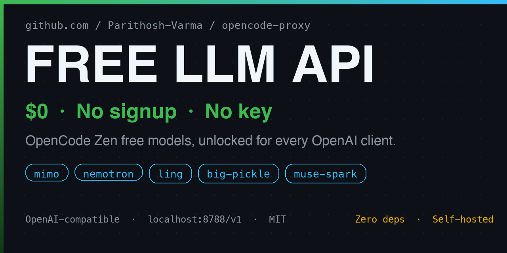

# opencode-proxy — free OpenAI-compatible LLM API (no key, no signup)

<p align="center">
  
</p>

Use OpenCode Zen's free large language models through a standard,
self-hosted OpenAI-compatible API — a free LLM proxy with zero dependencies.

[](https://nodejs.org)
[](LICENSE)
[](https://platform.openai.com/docs/api-reference)
[](#)
[](#quickstart)
[](#free-models-live-today)

### Frontier models. Zero dollars. Zero signup. Any OpenAI client.

Looking for a **free LLM API** or a **free OpenAI-compatible proxy** for
your agents, scripts, and IDE tools? OpenCode Zen ships free-tier AI models
— `mimo`, `nemotron`, `ling`, `big-pickle`, `muse-spark` — that normally
only answer inside the OpenCode CLI. **opencode-proxy unlocks them for
everything**: your scripts, your agents, your IDE, your chat UI. One local
server, one base-URL swap, and every tool you already own suddenly runs on
free frontier models. Self-hosted, no signup, no API key, no credit card.

```bash
git clone https://github.com/zkygwxf-bot-Varma/opencode-proxy.git
cd opencode-proxy && node proxy.mjs
# → http://127.0.0.1:8788/v1  (no key, no account, no card)
```

```python
from openai import OpenAI

client = OpenAI(base_url="http://127.0.0.1:8788/v1", api_key="anything")
r = client.chat.completions.create(
    model="mimo-v2.6-flash-free",
    messages=[{"role": "user", "content": "Explain closures briefly"}],
)
print(r.choices[0].message.content)
```

If you like it, star the repo — it helps others find free inference.

---

## Why this exists

Call a Zen free model directly and you get slapped with:

```json
{"type":"error","error":{"type":"FreeTierError",
 "message":"OpenCode's free tier can only be used from within OpenCode"}}
```

The free tier only answers requests that *look like OpenCode*: real session
headers, streaming transport, and an agentic payload carrying genuine
OpenCode tool definitions. Miss any one of those and you're rejected.

opencode-proxy does the handshake for you — on every request, invisibly —
then hands your client a boring, standard OpenAI response. **You write
normal OpenAI code. The proxy does the spy work.**

| | Direct call | Via opencode-proxy |
|---|---|---|
| Key / signup | Rejected without OpenCode identity | None. Zero. |
| Any OpenAI client | No — `FreeTierError` | Yes — SDKs, agents, IDEs, chat UIs |
| Streaming | Required, or rejected | Your choice — proxy adapts |
| Tools | 6+ real OpenCode tools or rejected | Auto-injected when missing |
| Cost | $0 | $0 |

## What you get — a free self-hosted AI gateway

- **9 free models, live today** — chat + reasoning + stealth + multimodal,
  all verified working (see table below)
- **Truly OpenAI-compatible** — `/v1/models`, `/v1/chat/completions`,
  `/v1/responses`, `/health`. If a tool takes a base URL, it works
- **Streaming and non-streaming** — the free tier only speaks SSE, so the
  proxy streams upstream and re-assembles clean JSON when you asked for
  `stream: false`
- **Invisible tool injection** — genuine OpenCode tools are added when yours
  are missing, with `tool_choice: "none"`, so you get plain text instead of
  stray `tool_calls`. Your own tools pass through untouched
- **Self-healing sessions** — route real OpenCode through the proxy once and
  it refreshes its own identity headers automatically
- **Zero dependencies** — a single `proxy.mjs`, Node 18+ stdlib only.
  Audit it in one sitting
- **Paid models ride free** — set `OPENCODE_API_KEY` and non-free Zen models
  proxy through the same endpoint, no extra config

## Quickstart — free LLM inference in 60 seconds

Requirements: Node 18+ and the `opencode` CLI. That's it — **no account, no
key, no card** for free models.

```bash
git clone https://github.com/zkygwxf-bot-Varma/opencode-proxy.git
cd opencode-proxy

# 1. Capture a session identity (~30s). Terminal A:
node capture.mjs

#    Terminal B:
mkdir -p /tmp/zencap && cat > /tmp/zencap/opencode.json <<'EOF'
{"$schema":"https://opencode.ai/config.json",
 "provider":{"opencode":{"options":{"baseURL":"http://127.0.0.1:18787/zen/v1"}}}}
EOF
cd /tmp/zencap && opencode run "say hi" \
  --model opencode/mimo-v2.6-flash-free --standalone
# capture.mjs saves session.json and exits.

# 2. Start printing free tokens:
node proxy.mjs   # or: PORT=8788 node proxy.mjs
```

`session.json` holds only session-affinity IDs (never a key) and expires
after a while — if `FreeTierError` ever returns, repeat step 1 (30 seconds).

**Shortcut:** point any OpenCode project's
`provider.opencode.options.baseURL` at `http://127.0.0.1:8788/zen/v1` and run
one command. The proxy learns fresh identity from that traffic and updates
`session.json` by itself.

## Plug it into your stack — works with every OpenAI client

Base URL `http://127.0.0.1:8788/v1`, any `api_key` value. Two changed lines and
you're running on free models:

| Your stack | What changes |
|---|---|
| Python / Node SDKs | `base_url` / `baseURL` → `http://127.0.0.1:8788/v1` |
| Continue, Cline, Roo Code | Add an OpenAI-compatible provider with that base URL |
| LiteLLM gateway | `api_base: http://127.0.0.1:8788/v1` |
| Chat UIs (Open WebUI, SillyTavern, …) | New OpenAI connection, same URL |
| Your weekend agent project | Swap the base URL, keep everything else |
| cURL diehards | Example below |

```bash
# Chat models
curl http://127.0.0.1:8788/v1/chat/completions \
  -H 'Content-Type: application/json' \
  -d '{"model":"mimo-v2.6-flash-free",
       "messages":[{"role":"user","content":"Explain closures briefly"}]}'

# Responses API (muse-spark free models)
curl http://127.0.0.1:8788/v1/responses \
  -H 'Content-Type: application/json' \
  -d '{"model":"muse-spark-1.3-contributor-free",
       "input":"Say hi in 5 words","store":false}'
```

## Free AI models, live today (no API key required)

Every ID below was verified working through this proxy:

| Model | Endpoint | Best for |
|---|---|---|
| `mimo-v2.6-flash-free` | `/v1/chat/completions` | Default pick — fast, sharp |
| `mimo-v2.5-free` | `/v1/chat/completions` | Previous generation |
| `nemotron-3-ultra-free` | `/v1/chat/completions` | Deepest Nemotron reasoning |
| `nemotron-3.5-lightning-free` | `/v1/chat/completions` | Low-latency answers |
| `ling-3.0-flash-fin-free` | `/v1/chat/completions` | Finance-tuned flash |
| `big-pickle` | `/v1/chat/completions` | The stealth model everyone asks about |
| `muse-spark-1.3-contributor-free` | `/v1/responses` | Meta multimodal flagship |
| `muse-spark-1.2-contributor-free` | `/v1/responses` | Previous generation |
| `jev-1.13-free` | `/v1/chat/completions` | Listed free tier |

Free IDs rotate (OpenCode marks them "limited time") — `/v1/models` always
shows the current set. Paid Zen models work through the same endpoints once
you set `OPENCODE_API_KEY`.

## Under the hood

```
your client ── plain OpenAI request ──► proxy ── OpenCode-identified,
                                         streaming + tools ──► Zen ($0)
```

Per request the proxy attaches `User-Agent: opencode/...` plus
`x-opencode-*` / `x-session-*` headers from `session.json`, forces
`stream: true` upstream (re-assembling SSE when you asked non-streaming),
and injects genuine OpenCode tool definitions when yours are missing. About
100 lines of readable Node — go look.

## FAQ — free LLM proxy questions

**Really no key, no signup?** Really. Free models ride the public tier,
exactly like a fresh `opencode` install. A key (`OPENCODE_API_KEY`) is only
ever needed for *paid* Zen models.

**Is this affiliated with OpenCode?** No — independent project, not built
or endorsed by them. Free-tier availability and rules are theirs and can
change anytime; star and enjoy while it lasts.

**It worked, now `FreeTierError`?** Session identity expired. Repeat the
30-second capture step.

**Will models call tools I never sent?** No. Missing tools are injected
with `tool_choice: "none"`, so you get clean text. Send your own tools and
they pass straight through.

**Can I run it for my whole team?** Host it on your LAN, put your key in
its env for paid models, and hand out the base URL. Clients still need no
keys of their own.

## License

MIT — see [LICENSE](LICENSE). If free inference saved you money, a star is
appreciated.

---

*opencode-proxy: a free, self-hosted, OpenAI-compatible LLM gateway for
OpenCode Zen's free-tier AI models — free chatbot API, free coding-assistant
models, and free agent inference with no signup and no API key. An
open-source alternative to paid LLM APIs for developers, researchers, and
hobbyists running local AI workflows.*
